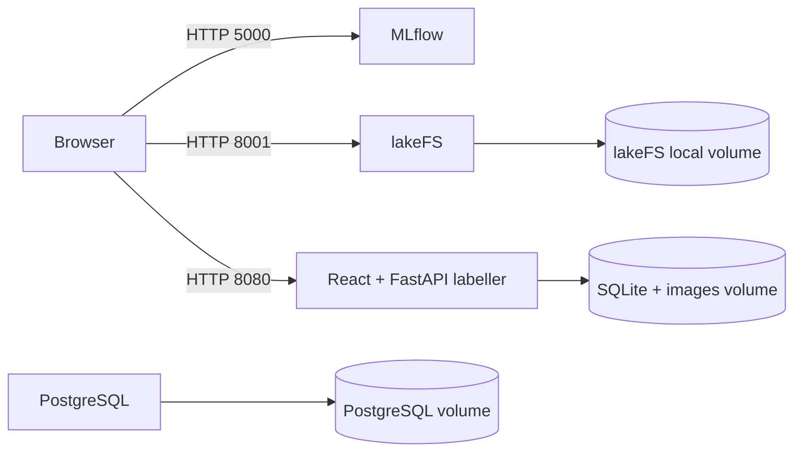

# Architecture

All containers share one Docker host and network. The labeller, MLflow, and lakeFS publish configurable direct host ports. PostgreSQL remains available for future database integration; neither application is currently configured to consume it. Labeller assets are compiled into its container image.
